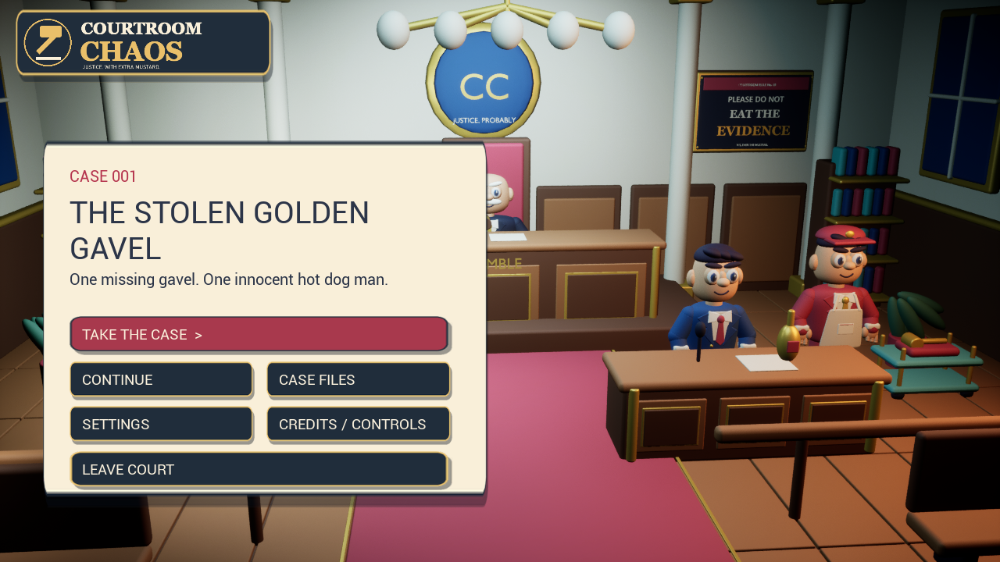
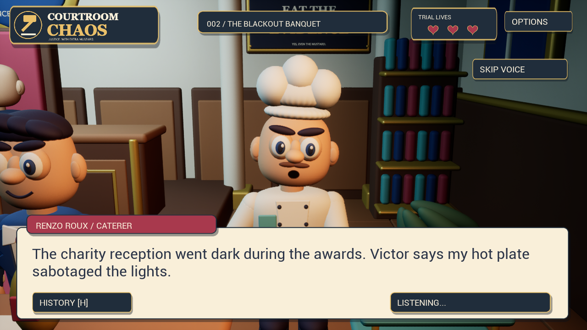
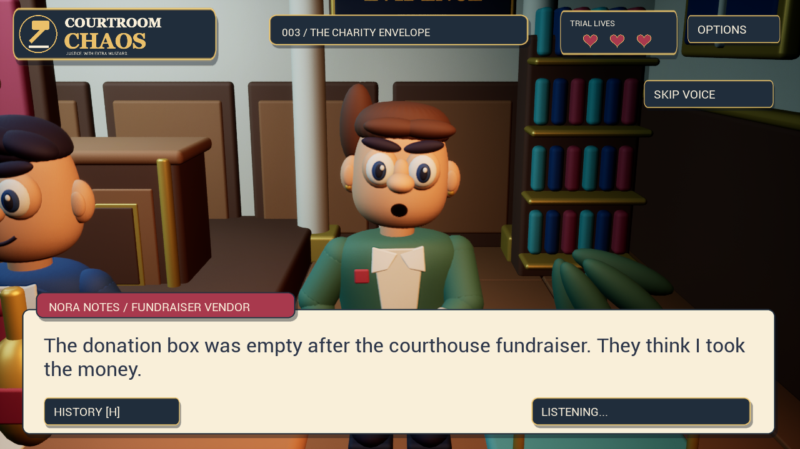
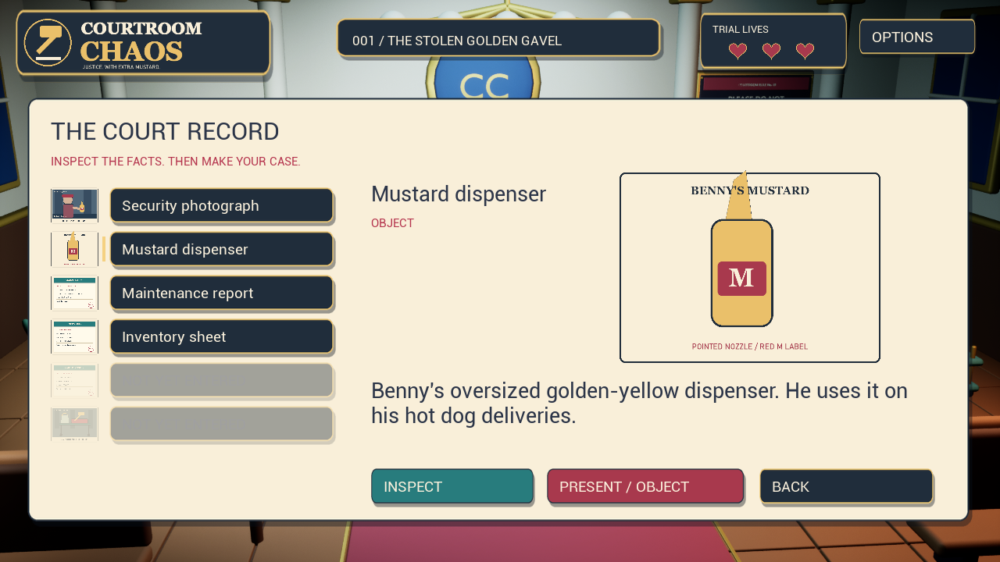
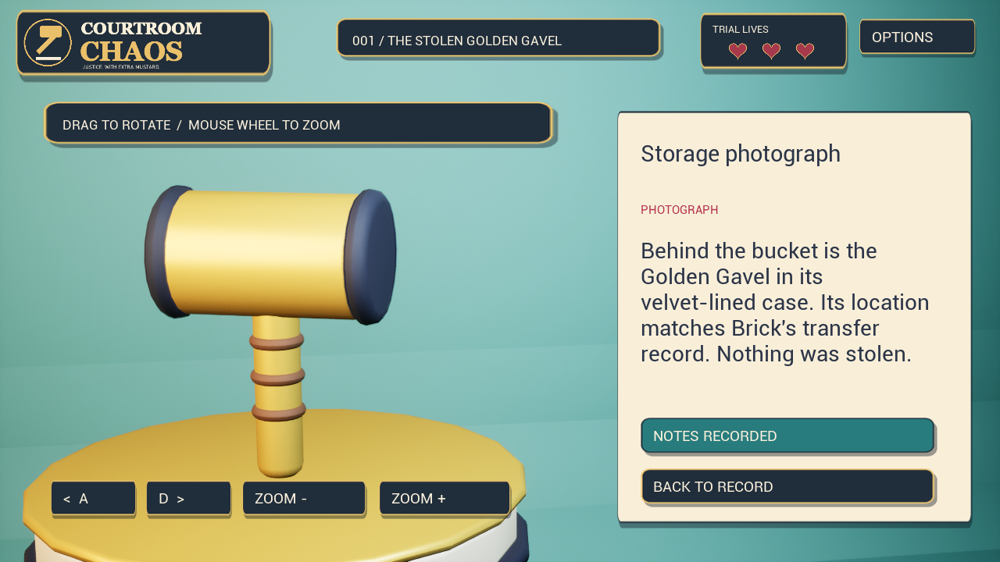

<div align="center">

# COURTROOM CHAOS

### Justice. With extra mustard.

A cartoon courtroom mystery game built with **Unreal Engine 5.8.3** and **Blender**.
Cross-examine eccentric witnesses, inspect the evidence, and keep your case alive.

[](https://github.com/AlbertinoTheCoder/Courtroom-Chaos/releases/latest)




**[Download & play](https://github.com/AlbertinoTheCoder/Courtroom-Chaos/releases/latest)** · **[Report a bug](https://github.com/AlbertinoTheCoder/Courtroom-Chaos/issues/new?template=bug_report.yml)** · **[Build from source](#build-from-source)**

</div>

## Play on Windows

1. Download **CourtroomChaos-Windows-x64.zip** from the [latest release](https://github.com/AlbertinoTheCoder/Courtroom-Chaos/releases/latest).
2. Extract the **entire ZIP** to a folder.
3. Double-click **CourtroomChaos.exe** in that folder.

Keep the `Game` folder beside the EXE: it contains Unreal's runtime and the game assets. No Unreal Editor, Python, model download, account, or internet connection is needed to play. This is a Windows x64 development build; broader hardware compatibility has not been verified. If Unreal asks for its prerequisites, run `vc_redist.x64.exe` and `GameInputRedist.msi` under `Game/Engine/Extras/Redist/en-us`.

In this source checkout, the root EXE launches the package under `Builds/Windows`. Build it locally or download the release to play. GitHub's **Code → Download ZIP** contains project source rather than the packaged runtime.

## Three cases. Three lives. Question everything.

| Case | The mystery | Your client and witness |
| --- | --- | --- |
| **001 · The Stolen Golden Gavel** | A missing gavel, an unreliable timeline, and a suspicious cart. | Benny Buns & Milo Mopps |
| **002 · The Blackout Banquet** | An awards reception loses power. Is a chef's hot plate to blame? | Renzo Roux & Pip Sparks |
| **003 · The Charity Envelope** | £480 disappears. A seal and a paper trail tell another story. | Nora Notes & Agnes Penny |

Every case moves through consultation, opening statements, three cross-examinations, contradiction resolutions, closing argument, and a verdict.

- **Build a deduction:** press for details, examine illustrated records, and rotate physical exhibits. Discoveries unlock more evidence.
- **Make your objection count:** valid proof focuses the contradicted claim automatically, whichever testimony page is selected.
- **Protect your three lives:** incorrect evidence or a wrong closing argument costs one life. Three mistakes mean restarting the case. Pressing and inspecting are free.
- **Hear the courtroom unravel:** offline synthetic character voices follow the text pace; four synchronized music layers react to the court's temper.
- **Return to your case:** separate save slots preserve each investigation. Continue restores the last active trial, including a failed attempt.

<table>
<tr>
<td><br><b>The Blackout Banquet</b></td>
<td><br><b>The Charity Envelope</b></td>
</tr>
<tr>
<td><br><b>Read the record. Find the contradiction.</b></td>
<td><br><b>Inspect the details.</b></td>
</tr>
</table>

## Controls

| Input | Action |
| --- | --- |
| Mouse | Select testimony, evidence, and interface buttons |
| Space | Advance dialogue; reveal text while a voice is speaking |
| Left / Right | Browse testimony |
| Q / E / H | Press / Court record / Transcript |
| Escape | Back, or save and return to the menu |
| Tab / Shift+Tab / Enter | Navigate and activate buttons |
| Drag or A / D · Mouse wheel | Rotate an exhibit · Zoom |

**Skip Voice** explicitly interrupts a spoken line. Continue waits for speech to finish. Settings include voice/text pace, text size, instant text, high contrast, reduced motion, graphics, window mode, and separate audio volumes.

## Build from source

The checked-in project includes editable Unreal content, C++ gameplay, Blender scenes, FBX exports, case scripts, and baked audio. It has no runtime AI-service dependency.

**Development tools:** Unreal Engine **5.8.3**, Visual Studio with C++ game development support and a Windows SDK. Blender **5.2** and Python are needed only to regenerate art/audio.

1. Clone this repository and open `CourtSimulator.uproject` in Unreal Engine 5.8.3.
2. Allow Unreal to build the C++ modules, or run `Tools/BuildProject.ps1`.
3. Open `/Game/Courtroom/L_Courtroom` and press Play.
4. Run `Tools/PackageGame.ps1` to create `Builds/Windows`, then open **CourtroomChaos.exe** at the repository root.

The PowerShell build scripts currently use the development machine's Unreal path `E:/UE_5.8` and Blender path `D:/Blender`; adjust those paths to your installation before running them. Regeneration scripts replace generated assets, so preserve manual edits first. Rebuild the small Windows launcher with `Tools/BuildLauncher.ps1`.

### Project map

| Folder | Contents |
| --- | --- |
| `Source/CourtSimulator` | Trial flow, evidence rules, UI, saves, speech timing, music and animation |
| `Content` | Editable Unreal assets and the courtroom level |
| `Art/Blender` | Original courtroom, rigged cast, and exhibit scenes |
| `Art/Cases` | Authored additional-case data |
| `Art/Voices` | Baked synthetic speech; no model weights |
| `Tools` | Asset generators, imports, build and release scripts |
| `Tests` | Editor and packaged integration checks |
| `Documentation` | Case design, art direction, audio credits, and development notes |

### Verification

```powershell
# Editor integration checks
.\Tests\RunTrialTest.ps1

# Packaged game checks after packaging
.\Tests\RunTrialTest.ps1 -Packaged
```

The latest Windows build passed progression for all three cases, valid evidence on all 27 stage/testimony combinations, strict three-life failure/restart behavior, independent saves, skeletal motion, desk/gavel choreography, and voice completion/text synchronization/adaptive music checks. Test data is isolated from player saves. GitHub's source check validates Python syntax and authored JSON; Unreal runtime tests require a local engine installation.

## Credits & project status

Created by **[AlbertinoTheCoder](https://github.com/AlbertinoTheCoder)** with Codex-assisted development. Characters, case scripts, scenes, procedural music, and interface assets are included in the project. Speech is synthetic, generated with Kokoro; see [audio credits](Documentation/AudioCredits.md). Unreal Engine is © Epic Games, Inc. and is governed by its own license.

This is a playable **three-case prototype**. The cast uses stylized procedural models and shared performance rigs. Recorded voice acting, articulated fingers, and broader hardware testing remain future work. Public source access does not grant a separate open-source license; third-party tools retain their respective terms.

